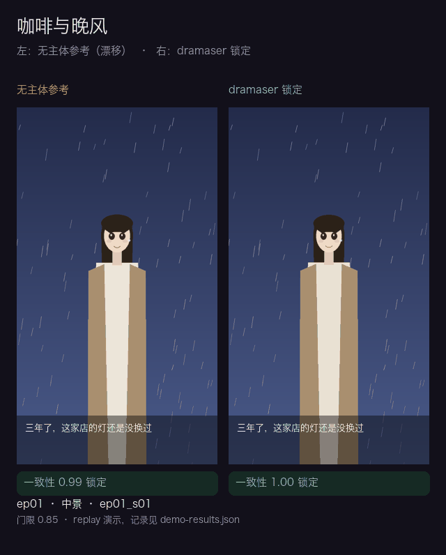

[English](./README.en.md) | **简体中文**

<picture>
  <source media="(max-width: 640px) and (prefers-color-scheme: dark)" srcset="assets/presentation/hero-mobile-dark.svg">
  <source media="(max-width: 640px)" srcset="assets/presentation/hero-mobile-light.svg">
  <source media="(prefers-color-scheme: dark)" srcset="assets/presentation/hero-dark.svg">
  
</picture>

# dramaser

**同一角色连出多集不漂移——竖屏微短剧的角色一致性产片工具，成片直出剪映。**


`v0.1.0` · `Python 3.12+` · [MIT](LICENSE)

[](https://github.com/SuperMarioYL/dramaser/releases)
[](https://www.python.org/)
[](./LICENSE)
[](#快速开始)
[](#配置)

[Demo 记录](docs/demo-results.json) · [CHANGELOG](CHANGELOG.md) · [English](./README.en.md)

## 为什么需要 dramaser

运营抖音/视频号竖屏 IP 或微短剧系列的小团队，把 AI 生成管线当主力产能之后，最先塌的不是"生成不出"，而是"生成了几十个长得不一样的同一角色"：通用文生视频逐条独立输出，角色脸型、发色、服装跨集漂移，而角色识别度直接决定这类账号的涨粉与商单。

OpenMontage、hyperframes 这类 agentic 视频生产底座解决了管线与渲染原语，但 Agent 批量生产移除了人工美术兜底，却没有给出系列级的角色一致性层——continuity 在它们那里只是一个评分项，不是有状态的资产。dramaser 不是它们的中文版，而是接上中国交付面的那一层：

- **角色设定集跨集锁定**：`appearance_lock` 契约写进每一次主体参考生成，参考图锚定形象；
- **分镜级局部重生成**：镜头血缘（lineage）记录每个镜头的参数哈希与评分，`regen` 只重烧漂移镜头，其余产物原样复用；
- **平台规范即代码**：9:16、60s 时长档、字幕安全区全部进 `series.yaml`，成片直接导出为剪映可打开的 draft。

这层竖屏系列规范本身被打包成可复用的 Skill 资产——角色设定集是标准格式，团队交接就是交接一个 git 仓库。

## 实际 Demo

<picture>
  <source media="(max-width: 640px) and (prefers-color-scheme: dark)" srcset="assets/presentation/process-mobile-dark.svg">
  <source media="(max-width: 640px)" srcset="assets/presentation/process-mobile-light.svg">
  <source media="(prefers-color-scheme: dark)" srcset="assets/presentation/process-dark.svg">
  
</picture>

同一角色连出 3 集，无锁定漂移 vs dramaser 锁定（录制自 v0.1 demo replay，输入与版本记录于 [docs/demo-results.json](docs/demo-results.json)）：



replay 模式下，左右两路来自同一套预置角色参数：无主体参考的一路按集累积漂移（第 1 集侥幸过关、第 2/3 集被一致性门拦下），锁定的一路 9/9 通过。上表即命令的真实输出：

```text
$ uv run dramaser demo
demo 完成（replay 模式，无 API key）
  对比 GIF   : dramaser-demo/demo-drift-vs-locked.gif
  一致性报告 : dramaser-demo/consistency-report.md
  剪映 draft : dramaser-demo/jianying/dramaser_demo/draft_content.json
  无锁定     : 6/9 镜头漂移（门限 0.85）
  dramaser   : 9/9 镜头锁定
  拷入剪映   : 重跑加 --install-draft
```

`check draft` 对导出工程的机器校验：

```text
9:16 画布（1080x1920）    通过   1080x1920
视频轨 + 字幕轨           通过   video=1 text=1
素材文件全部存在          通过   全部在盘
视频段连续无空洞          通过   总时长 43.0s
每集不超时长档（60s）     通过   3 集全部达标
字幕全部位于安全区        通过   9 条字幕达标（bottom≥12%）
```

## 快速开始

需要 Python 3.12+ 与 [uv](https://docs.astral.sh/uv/)。demo 路径零 API key、零 ffmpeg（Pillow 确定性回放）。

```bash
git clone https://github.com/SuperMarioYL/dramaser.git
cd dramaser
uv run dramaser demo            # <10s：对比 GIF + 一致性报告 + 剪映 draft
```

不想克隆仓库，也可以从 git 直接运行（已内置全部预置资产）：

```bash
uvx --from git+https://github.com/SuperMarioYL/dramaser dramaser demo
```

发布到 PyPI 后 `uvx dramaser demo` 同样可用（见 [Release](https://github.com/SuperMarioYL/dramaser/releases)）。

**把 draft 装进剪映**（本机已装剪映）：

```bash
uv run dramaser demo --install-draft   # 拷入剪映草稿目录，打开剪映即见 3 集时间轴
```

**开始你自己的系列**（live 生成需要 [Vidu](https://www.vidu.cn/) 与 [智谱](https://open.bigmodel.cn/) key）：

```bash
export VIDU_API_KEY=... ZHIPU_API_KEY=...
uv run dramaser init --preset ayao my-series   # 生成可编辑的 series.yaml
cd my-series
uv run dramaser generate ep01                  # 主体参考生成 + 逐镜头过一致性门
uv run dramaser regen ep01_s03                 # 只重生成漂移镜头，其余血缘不动
uv run dramaser export ep01 --install-draft    # 导出新 draft 并拷入剪映
```

完整输入与录制的输出见 [docs/demo-results.json](docs/demo-results.json)；三步上手示例见 [examples/quickstart.md](examples/quickstart.md)。

## 架构

<picture>
  <source media="(max-width: 640px) and (prefers-color-scheme: dark)" srcset="assets/presentation/architecture-mobile-dark.svg">
  <source media="(max-width: 640px)" srcset="assets/presentation/architecture-mobile-light.svg">
  <source media="(prefers-color-scheme: dark)" srcset="assets/presentation/architecture-dark.svg">
  
</picture>

单进程 Python CLI，零服务、零守护进程。`series.yaml` 单一工程文件驱动整条管线：分镜展开 → 生成/回放 → 一致性门 → 血缘落盘。外部依赖只有 ffmpeg 二进制（live 模式评审视频时抽帧）。

| 模块 | 职责 |
| --- | --- |
| [series.py](src/dramaser/series.py) | SeriesAsset 模式（pydantic）+ 块式 YAML 读写 + 预置角色集加载 |
| [storyboard.py](src/dramaser/storyboard.py) | 镜头/血缘结构 + 平台规则引擎（9:16 几何、安全区、时长档） |
| [providers/base.py](src/dramaser/providers/base.py) | Provider 接口 + replay 确定性渲染引擎（无 key demo） |
| [providers/vidu.py](src/dramaser/providers/vidu.py) | Vidu 主体参考 live 生成（img2video + 任务轮询） |
| [consistency.py](src/dramaser/consistency.py) | 角色设定集锁定 prompt + GLM-4V-Flash 结构化评审 + 门 |
| [jianying.py](src/dramaser/jianying.py) | 剪映 draft 导出 / 拷入 / `check draft` 校验 |
| [report.py](src/dramaser/report.py) | 漂移 vs 锁定对比 GIF + 一致性报告 + demo 记录 |
| [cli.py](src/dramaser/cli.py) | demo / init / generate / regen / export / check |

镜头血缘是分镜级重生成的依据：每个镜头落盘 `run_id / provider / params_hash / judge_score / status`，`regen` 只替换 `status=drifted` 的镜头，其余镜头复用已锁定产物，不重烧 API。

## 能力与接入

<picture>
  <source media="(max-width: 640px) and (prefers-color-scheme: dark)" srcset="assets/presentation/integrations-mobile-dark.svg">
  <source media="(max-width: 640px)" srcset="assets/presentation/integrations-mobile-light.svg">
  <source media="(prefers-color-scheme: dark)" srcset="assets/presentation/integrations-dark.svg">
  
</picture>

| 能力 | 状态 | 说明 |
| --- | --- | --- |
| 无 key 回放 demo | 已实现 | 预置角色集 + 确定性渲染夹具，全链路可复现 |
| Vidu 主体参考生成 | 已实现（需 key） | 按公开 ent/v2 文档实现，线格式隔离在两个方法内，未在真实 key 上验证过 |
| GLM-4V-Flash 一致性门 | 已实现（需 key） | prompt 约定 JSON 输出并防御性解析；评分低于阈值标记 drifted |
| 剪映 draft 导出 | 已实现 | pyJianYingDraft 0.3：9:16 画布、安全区字幕轨、时长档分段、`--install-draft` |
| 分镜级 regen | 已实现 | 只重烧目标/漂移镜头，血缘与产物逐镜头保留 |
| 漂移对比 GIF 与报告 | 已实现 | Pillow 拼帧 + Markdown 报告，README 与 demo 共用同一产物 |

边界声明：

- replay 帧由预置角色参数用 Pillow 确定性渲染，是漂移-锁定的示意可视化，**不是模型输出**；其评分为渲染参数签名与锁定基准的加权距离，与 GLM-4V-Flash 门共用同一接口。
- live 模式评审视频镜头时需要 PATH 中有 ffmpeg。
- 一致性评分是质量门，不是绝对真值；阈值可配，建议人工抽查 drifted 判定。

## 配置

`series.yaml` 是唯一工程文件（`dramaser init` 生成的即是完整模板）：

```yaml
characters:
  - id: ayao
    appearance_lock:      # 角色设定集锁定契约，写进每次主体参考 prompt
      脸型: 鹅蛋脸，下颌线柔和，左耳戴银色小星耳钉
      发型: 黑棕色长直发，中分，发尾微卷
    reference_images: [reference/ayao.png]
style:
  palette_lock: ["#2b2340", "#a98f6f", "#e9e1d3"]
  negative_lock: [多手指, 面部畸变, 画面模糊]
platform:
  preset: douyin_60s      # 9:16 / 60s 时长档 / 字幕安全区（top 8% bottom 12% right 10%）
  duration_tier: 60
gates:
  consistency_threshold: 0.85
```

- 环境变量：`VIDU_API_KEY`（live 生成）、`ZHIPU_API_KEY`（GLM-4V-Flash 评审）、`DRAMASER_ASSETS`（自定义预置资产目录，默认仓库 `assets/`，安装包内置同源副本）。
- 分镜字段：`id / characters / line / action / camera / duration_s`；`camera` 支持远景/中景/近景/特写。
- 修改角色：编辑 `appearance_lock` 与参考图即可；预置角色集在 [assets/presets/ayao/](assets/presets/ayao/)，含再生成参考图的说明。

## 付费与商业

dramaser 面向商业承制团队，变现不靠锁 CLI：

- **CLI 与 SeriesAsset 格式**：MIT 开源，永久免费。角色设定集是标准资产格式，git 在你自己手里。
- **系列试点包（当前在售）**：¥9,800 / 系列（3 集）——按你的真实角色建角色设定集、接入你的 Vidu/智谱 key、交付 3 集可直接打开的剪映 draft、含 2 小时上手协作。通过 [Issues](https://github.com/SuperMarioYL/dramaser/issues) 建立联系。
- **托管团队工作台（v0.2+ 规划）**：¥99/人/月——角色资产库、系列工程协作与权限；CLI 保持免费。定价参考：人工重烧 3 集漂移素材的 API 成本已接近月费。

格式开源 + 在环控制闭源，是刻意的：护城河在角色锁定契约与镜头血缘和平台规则的组合上，不在协议发明。

## 路线图

- **v0.1（当前）**：replay demo、剪映 draft 导出与校验、Vidu live 生成 + GLM-4V-Flash 一致性门 + 分镜级 regen。
- **v0.2 计划**：本地 CLIP embedding 评审（门接口不变）、可灵 Kling adapter（provider 接口已留扩展点）、托管团队工作台。
- **明确不做（v0.1）**：Web 工作台（CLI 先行，团队交接靠 git）、剧本到分镜的 LLM 自动拆解（手写 YAML 分镜）、TTS 配音与声音克隆（设定集只存 voice 字段）、ASR 自动字幕（字幕取自分镜 line 字段）、BGM 选配、自动发布抖音/视频号、多用户账号系统。

## 许可证

[MIT](LICENSE) · 角色设定集与预置资产同样以 MIT 提供。

<p align="center"><sub><a href="./LICENSE">MIT</a> © 2026 SuperMarioYL</sub></p>
